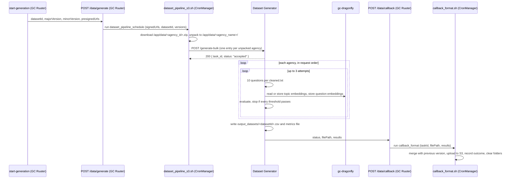

# Dataset Generator

**Open-source, generic synthetic dataset generator.** Build the Docker image once and reuse it inside **any external project's** `docker-compose.yml` by mounting your configurations.

## What is this?

This is a containerized synthetic dataset generation service designed for embedding into external projects. It provides:

- **Generic architecture**: Works with any LLM provider (Ollama, OpenAI, etc.)
- **Template-driven generation**: Customizable prompts and output structures
- **Multi-tenant support**: Different configurations per agency/project
- **RESTful API**: Generate datasets programmatically with background processing
- **Docker-first design**: Deploy anywhere with consistent behavior

## Quick Start

1. **Clone and start services:**
```bash
git clone https://github.com/rootcodelabs/Dataset-Generator.git
cd Dataset-Generator
docker compose up -d
```

This starts the API and Dragonfly, the Redis-compatible embedding cache used by the evaluation step. The API waits until Dragonfly is healthy.

2. **Verify services are running:**
```bash
curl http://localhost:8000/health
curl http://localhost:8000/embeddings/health   # "cache_healthy": true
```

3. **Generate your first dataset:**
```bash
curl -X POST "http://localhost:8000/generate" \
  -H "Content-Type: application/json" \
  -d '{
    "dataset_structure": "single_question",
    "prompt_template": "institute_topic_question",
    "num_samples": 5,
    "language": "et"
  }'
```

Check generated datasets in `./output_datasets/`

## Use in Another Project

### Option A: Use Published Image

Add this service to your existing `docker-compose.yml`:

```yaml
version: '3'

services:
  # Your existing services...
  
  dataset-generator:
    image: synthesisai/dataset-generator:latest
    ports:
      - "8000:8000"
    environment:
      - PROVIDER_API_URL=http://your-llm-provider:11434
      - MLFLOW_TRACKING_URI=http://your-mlflow:5000
      - CACHE_URL=redis://dragonfly:6379
    volumes:
      - ./your-templates:/app/templates
      - ./your-configs:/app/user_configs
      - ./your-data:/app/data
      - ./generated-datasets:/app/output_datasets
      - ./logs:/app/logs
    networks:
      - your-network
    depends_on:
      dragonfly:
        condition: service_healthy

  # Required: embedding cache for the evaluation step.
  # See docker-compose.yml in this repo for the full flag set.
  dragonfly:
    image: ghcr.io/dragonflydb/dragonfly:v2.0.2
    command:
      - --proactor_threads=2
      - --maxmemory=1gb
      - --cache_mode=true
      - --dir=/data
      - --snapshot_cron=*/15 * * * *
    mem_limit: 1280m
    ulimits:
      memlock: -1
    volumes:
      - dragonfly_data:/data
    healthcheck:
      test: ["CMD-SHELL", "redis-cli ping | grep -q PONG"]
      interval: 5s
      retries: 10
    networks:
      - your-network

  # Optional: Include Ollama if you don't have an LLM provider
  ollama:
    image: synthesisai/dataset-generator-ollama:latest
    ports:
      - "11434:11434"
    environment:
      - NVIDIA_VISIBLE_DEVICES=all
    deploy:
      resources:
        reservations:
          devices:
            - driver: nvidia
              count: 1
              capabilities: [gpu]
    volumes:
      - ollama_models:/root/.ollama
    networks:
      - your-network
```

### Option B: Build & Push Custom Tag

1. **Customize the service:**
```bash
# Modify config/config.yaml, templates/, etc.
# Add your custom templates and configurations
```

2. **Build with your tag:**
```bash
docker build -f Dockerfile.service -t your-org/dataset-generator:v1.0 .
docker build -f Dockerfile.ollama-gpu -t your-org/dataset-generator-ollama:v1.0 .
```

3. **Push to your registry:**
```bash
docker push your-org/dataset-generator:v1.0
docker push your-org/dataset-generator-ollama:v1.0
```

4. **Use in your project:**
```yaml
services:
  dataset-generator:
    image: your-org/dataset-generator:v1.0
    # ... rest of configuration
```

## Integration with Global Classifier

[Global Classifier](https://github.com/buerokratt/Global-Classifier) (GC) uses this service to build its training datasets. GC downloads each agency's Common Knowledge Base (CKB) data and unpacks it into a shared folder. This service then generates synthetic citizen questions from it, labelled with the agency. GC merges the questions into a new dataset version and trains its classifier on that version.

GC only calls `POST /generate-bulk`. It does not use `/generate` or the `/embeddings/*` endpoints.

This section describes GC's current `DSL/`, `src/s3_dataset_processor/` and `docker-compose*.yml`. If you change either side of the contract, update this section.

### Components

| Component | Container | Address on `bykstack` | Role |
|---|---|---|---|
| Dataset Generator (this service) | `dataset-gen-service` (`gc-dataset-gen-service` with `docker-compose.local-test.yml`) | `http://dataset-gen-service:8000` | Generates and evaluates questions, writes the CSV, calls back |
| Embedding cache | `gc-dragonfly` | `redis://gc-dragonfly:6379` (host: `127.0.0.1:6378`) | Topic and question embeddings for the evaluation step |
| CronManager | `cron-manager` | `http://cron-manager:9010` | Runs the download job (`dataset_pipeline_s3.sh`) and the callback job (`callback_format.sh`) |
| Ruuter public | `ruuter-public` | `http://ruuter-public:8086/global-classifier` | `POST /data/generate`, `POST /data/callback`, progress and status endpoints |
| Resql | `resql` | `http://resql:8082/global-classifier` | Dataset version and agency queries |
| S3 Ferry | `gc-s3-ferry` | `http://gc-s3-ferry:3000` | Copies CSVs between the shared folder and GC's S3 bucket |

GC's `constants.ini` holds these addresses. CronManager mounts it at `/app/constants.ini`.

### End-to-end flow



GC tracks each run in a progress session that the GUI displays:

| Progress | Status text | Set by |
|---|---|---|
| 10% | Downloading Source Datasets | `dataset_pipeline_s3.sh`, before downloading |
| 40% | Calling Dataset Generation | `dataset_pipeline_s3.sh`, after unpacking |
| 60% | Dataset Generation In progress | `dataset_pipeline_s3.sh`, after this service returns `200` |
| 85% | New Dataset Uploading to s3 | `callback_format.sh`, when the callback arrives |
| 100% | Success | the callback processor, after the upload and the clean-up |
| 100% | Fail | either script, when a step fails |

### Step 1: GC starts a run

1. GC's `POST /agencies/data/start-generation` claims every `PENDING` agency data request. Each claimed row has `requestId`, `agencyId`, `agencyName`, `dataUrl` and `isNewAgency`. `dataUrl` is CKB's presigned URL for the agency's zip.
2. It creates a dataset version: a major version if any claimed agency is new, otherwise a minor one. It then calls `POST /data/generate` with `datasetId`, `majorVersion`, `minorVersion` and `presignedUrls` (the claimed rows).
3. `POST /data/generate` URL-encodes `JSON.stringify(presignedUrls)` and starts the CronManager job `dataset_pipeline_scheduler/dataset_pipeline_schedule`. It passes `signedUrls`, `datasetId`, `majorVersion` and `minorVersion` as environment variables.
4. Only one run happens at a time. While a dataset version is in progress, `start-generation` leaves new requests `PENDING`.

### Step 2: GC downloads and unpacks the agency data

`dataset_pipeline_s3.sh` creates the progress session and runs `src/s3_dataset_processor/download_source_dataset.py --encoded-data "$signedUrls" --extract-files --output-json /tmp/download_response.json` in the CronManager container.

**What the zip contains.** CKB zips the agency's folder `uploads/scrapped-data/<agency_id>/` into `zipped/<agency_id>.zip`, with paths inside the zip relative to that folder. The folder has one sub-folder per source document, and each sub-folder holds that document's `cleaned.txt` with its other files, such as `source.meta.json`:

```text
<agency_id>.zip
├── <source_folder_1>/
│   ├── cleaned.txt
│   └── source.meta.json
└── <source_folder_2>/
    ├── cleaned.txt
    └── source.meta.json
```

**Where the zip goes, step by step:**

| Step | Path | Notes |
|---|---|---|
| Download | `/app/data/<file name>` | The file name is the last part of the presigned URL's path, so `<agency_id>.zip`. If the URL has no path, it is `<agencyId>.zip`. The download times out after 300 seconds. |
| Unpack | `/app/data/temp_<agency_name>/` | Temporary folder. Only files whose name ends in `.zip` are unpacked. |
| Move | `/app/data/<agency_name>/` | **This is the folder the generator reads.** If the zip held a single top-level folder, the contents of that folder are moved here instead, so that folder level is dropped. |
| Tidy up | — | The temporary folder and the zip are deleted. |

The folder is named after the agency's **name** (`agencyName`, or `Unknown Agency` if it is missing), not its ID. `/app/data` is the `cron_data` Docker volume. CronManager and this service both mount it at `/app/data`, so this service sees the same path.

When unpacking has finished, the folder looks like this:

```text
/app/data/                      # cron_data volume
└── <agency_name>/              # data_path sent to /generate-bulk
    ├── <source_folder_1>/      # "topic" in the evaluation step
    │   ├── cleaned.txt         # source text the questions are generated from
    │   └── source.meta.json    # not read by this service
    └── <source_folder_2>/
        └── cleaned.txt
```

The download script writes a JSON summary to `/tmp/download_response.json`, with `success`, `downloaded_files[]` (each with `agency_id`, `agency_name`, `local_path`, `extraction_success`) and `extracted_folders[]` (each with `agency_id`, `agency_name`, `folder_path`).

**Download or unpack failures:**

- If no file downloads, or none unpacks, the script sets the progress session to Fail. It then posts `Generation_Failed` to `POST /agencies/data/generation` with the affected agencies as `Sync_with_CKB_Failed`, clears `/app/data`, and exits. This service is not called.
- If only some agencies fail, the rest continue. The failed agencies are left out of the request to this service. When GC records the outcome, their requests become `FAILED`, because they are not reported as `Synced_with_CKB`.

### Step 3: GC calls `POST /generate-bulk`

`dataset_pipeline_s3.sh` builds one entry per item in `extracted_folders` and posts them to `${GLOBAL_CLASSIFIER_DATASET_GENERATOR}/generate-bulk`:

```json
{
  "datasets": [
    {
      "agency_id": "<agency_id>",
      "agency_name": "<agency_name>",
      "data_path": "/app/data/<agency_name>",
      "output_filename": "<datasetId>",
      "version_id": "<datasetId>",
      "session_id": "<progress session id>"
    }
  ]
}
```

| Field | Type in the request | How this service uses it |
|---|---|---|
| `data_path` | string | Folder that is searched for `**/cleaned.txt`. It must not be empty or contain `..`. |
| `agency_name` | string, extra field | Output folder name, `output_datasets/<agency_name>/`. Copied into the `agency_name` column. |
| `agency_id` | string, extra field | Copied into the `agency_id` column. This is the classifier's label. |
| `output_filename` | string | Name of the combined CSV, `<datasetId>.csv`. Only letters, digits, `_` and `-` are allowed. The first entry's value is used for the whole run. |
| `version_id` | string | Prefix of `item_id` and value of `dataset_version_id`. Only letters, digits, `.`, `_` and `-` are allowed. |
| `session_id` | string, parsed as `int` | Returned as `task_id` and `session_id` in the callback. The first entry's value is used for the whole run. |

**Response:**

- `200` with `{ "task_id": "<uuid>", "status": "accepted", "message": "..." }`. The `task_id` is this service's own ID, not GC's. Generation continues as a FastAPI background task.
- `422` if a field fails validation. For example, if the script could not create a progress session, `session_id` is `"null"` and cannot be parsed as an integer.
- `500` if the embedding cache is unreachable, or for any other error. The route checks the cache with a `503`, but its error handler turns that into a `500`.

On any status other than `200`, the script sets the progress session to Fail, posts `Generation_Failed` for every agency, and clears `/app/data`.

### Step 4: The service generates questions

Agencies are processed one at a time, in request order (`process_single_dataset` in [src/api/routes.py](src/api/routes.py)). For each agency:

1. **Find the source files.** The `pattern` traversal strategy searches `data_path` with `glob("**/cleaned.txt", recursive=True)`. If nothing is found, the agency fails with `No data sources found matching the criteria in <data_path>`.
2. **Build the prompt.** The prompt is `user_configs/prompts/institute_topic_question.txt` with the `single_question` structure. The prompt parameters come from `dataset_generation.parameters` in `config.yaml`: Estonian (`et`), temperature `0.7`, difficulty `medium`, style `clear and concise`. Each file adds `file_path`, `file_name` (`cleaned.txt`), `file_content` (the text) and `relative_path`.
3. **Generate.** The service makes `num_samples` (`10`) questions per `cleaned.txt`, with the provider in `provider.name`. It writes them to:

   ```text
   output_datasets/<agency_name>/<source_folder>/cleaned.txt/   # a folder named after the source file
   ├── faqs.json        # [{"question": "..."}, ...]
   └── metadata.json    # parameters, including file_content
   ```

4. **Time limit.** `processing.timeout_seconds` (`1300` in GC's config, about 22 minutes) applies to each agency on its own. It is checked before each source file. When it runs out, the agency fails with `Processing timeout after 1300 seconds`.
5. **Partial failures.** If one file fails to generate, the others continue. The agency fails only if every file fails.

### Step 5: The service evaluates and regenerates

After each attempt, the service checks that the questions cover the source text. It uses `paraphrase-multilingual-mpnet-base-v2` embeddings cached in `gc-dragonfly`.

- **Agency and topic.** These are read from the source path: the second-to-last folder is the topic, and the one before it is the agency. For `/app/data/<agency_name>/<source_folder>/cleaned.txt`, the agency is `<agency_name>` and the topic is `<source_folder>`.
- **Topic embeddings.** One embedding of the `cleaned.txt` text, cached under `embeddings:persistent:<agency_name>:<source_folder>`. These keys never expire. Dragonfly's `--cache_mode=true` evicts them when memory is full.
- **Question embeddings.** One embedding per question, cached under `embeddings:temp:<uuid>` for 3600 seconds. The key is deleted before each new attempt.
- **Scores for each topic.** These come from the cosine similarity between the questions and the topic text:
  - **similarity:** the mean over questions of each question's best match
  - **coverage:** the share of topics whose best match is at least `0.5`
  - **information:** the mean of all similarities
  - **context score:** the mean of the three
- **Scores for the agency.** `topic_coverage`, `information_coverage` and `similarity_coverage` are the means of the per-topic scores, and `overall_score` is their mean.
- **Pass.** Every one of these must hold: `topic_coverage >= 0.7`, `information_coverage >= 0.6`, `similarity_coverage >= 0.6`, `overall_score >= 0.65`, and every topic's context score `>= 0.5`. Otherwise the whole agency is generated again.
- **Attempts.** At most `evaluation.max_regeneration_attempts` (`3`). If no attempt passes, the attempt with the highest `overall_score` is kept. **Failing the evaluation does not fail the agency.** It is still reported with `success: true`.

### Step 6: The service writes the CSV

When every agency is done, the service combines the `faqs.json` files of all successful agencies into one CSV. This is `post_processing: aggregation` with `aggregation.output_format: csv`:

- **Path:** `output_datasets/<datasetId>.csv`. The path is relative to the service's working directory, `/app`.
- **Order:** agencies in request order, with no shuffling (`enable_shuffling: false`).

| Column | Value | Source in `config.yaml` |
|---|---|---|
| `item_id` | `<datasetId>_<n>`, numbered across all agencies from 1 | `defaults.item_id: auto_increment` |
| `agency_name` | `agency_name` from the request | `payload_to_output` |
| `agency_id` | `agency_id` from the request | `payload_to_output` |
| `data_item` | The generated question | `content_fields.question: data_item` |
| `dataset_version_id` | `int(version_id)`, the dataset ID | `defaults.dataset_version_id` |

The service also writes `output_datasets/metrics/<datasetId>_full_metrics.json`. It contains each agency's request, `success`, evaluation `metrics` (scores, `failed_metrics`, `context_coverage`), `regeneration_attempts`, `generation_errors` and `error_details`, with a `summary_metrics` block for the run.

If no agency succeeded, no CSV is written and `filePath` in the callback is `null`.

### Step 7: The service calls back

The service posts the result to `callback.url`, which is `http://ruuter-public:8086/global-classifier/data/callback`. It tries up to 3 times (`callback.retries`) with exponential backoff, and `callback.timeout` (`60` seconds) limits the total time. A timeout, a connection error or a `4xx`/`5xx` response counts as a failed attempt. If every attempt fails, the task's `callback_status` becomes `failed` in `GET /task-status/{task_id}`.

```json
{
  "task_id": 42,
  "session_id": 42,
  "status": "completed",
  "message": "Processing completed. 2 successful, 0 failed",
  "filePath": "output_datasets/<datasetId>.csv",
  "results": [
    { "dataset_metadata": { "agency_id": "...", "agency_name": "...", "data_path": "...", "output_filename": "...", "version_id": "...", "session_id": 42 }, "success": true },
    { "dataset_metadata": { "...": "..." }, "success": false, "error": "No data sources found matching the criteria in /app/data/<agency_name>" }
  ],
  "metrics_file": "output_datasets/metrics/<datasetId>_full_metrics.json",
  "summary": {
    "total_datasets": 2,
    "successful_datasets": 2,
    "failed_datasets": 0,
    "total_generation_errors": 0,
    "error_categories": {},
    "processing_completed_at": "2026-11-18 10:15:00",
    "has_partial_failures": false
  }
}
```

- `task_id` and `session_id` are GC's progress session ID, as an integer.
- `status` is `completed` when every agency succeeded, `partial_success` when some failed, and `failed` when all failed.
- `results` has one entry per agency, in request order.
- If the whole background task crashes, the payload instead has `status: "failed"`, `error`, `error_category` and `summary.critical_failure: true`, and no `filePath` or `results`. In that payload `task_id` is this service's own UUID.

### Step 8: GC processes the callback

1. `POST /data/callback` (`DSL/Ruuter.public/global-classifier/POST/data/callback.yml`) checks `status`:
   - **`success`:** it starts the CronManager job `callback_formatter/callback_format` with `taskId`, `filePath` and `results` (URL-encoded JSON).
   - **`failed` or `error`:** it takes the dataset ID from the file name (`<datasetId>.csv`). If there is no file path, it uses the dataset version that is in progress. It then posts `Generation_Failed`, and returns `500` if that update fails, so that this service retries.
   - **Any other value:** it returns `200` and does nothing. See [Known issues](#known-issues).
2. `callback_format.sh` sets the progress session to 85%. It takes the dataset ID from `filePath` and runs `dataset_generation_callback_processor.py`, which:
   1. Reads `filePath` as given, so `output_datasets/<datasetId>.csv` relative to CronManager's working directory. CronManager mounts the same `DSL/DatasetGenerator/output_datasets` host folder at `/app/output_datasets`.
   2. Downloads the previous successful version's CSV from S3 (`datasets/<previousId>/aggregated_dataset.csv`) to `/app/output_datasets/<previousId>_prev.csv`.
   3. Removes the previous rows of the agencies in this run, then appends this run's rows. It also drops agencies outside the network, and renumbers `item_id` and `dataset_version_id`. The result is written to `/app/output_datasets/<datasetId>_aggregated.csv`.
   4. Loads the CSV into the `datasets` table (`POST /datasets/update`) and uploads it to S3 as `datasets/<datasetId>/aggregated_dataset.csv`.
   5. Posts the outcome to `POST /agencies/data/generation`. Each agency is `Synced_with_CKB` if its `success` is `true`, otherwise `Sync_with_CKB_Failed`. The version is `Generation_Success` only if every agency in `results` succeeded.
   6. **Deletes everything in `/app/data` and `/app/output_datasets`**, including this service's per-agency folders, the CSV and the metrics file. It then sets the progress session to Success (100%).
3. If the processor fails, `callback_format.sh` posts `Generation_Failed` for the dataset and sets the progress session to Fail. It also deletes everything in `/app/data` except `processed/`, but leaves `/app/output_datasets` in place.

### Shared folders

| Folder in this service | Host or volume | Also mounted in | Written by | Cleared |
|---|---|---|---|---|
| `/app/data` | `cron_data` volume | `cron-manager`, `init` (sets permissions), and `gc-s3-ferry` in the dev file, all at `/app/data` | GC's download script | After a successful callback. After a failed download, generator call or callback, everything except `processed/` is cleared. |
| `/app/output_datasets` | `./DSL/DatasetGenerator/output_datasets` | `cron-manager`, `gc-s3-ferry`, `resql` and `users_db`, all at `/app/output_datasets` | This service, and the callback processor | After a successful callback only |
| `/app/config` | `./DSL/DatasetGenerator/config` | CronManager (`/app/config`) | — | — |
| `/app/user_configs` | `./DSL/DatasetGenerator/user_configs` | — | — | — |
| `/app/templates` | `./DSL/DatasetGenerator/templates` (empty) | — | — | — |
| `/app/logs` | `./DSL/DatasetGenerator/logs` | — | This service, `<date>_synthetic_data_service.log` | Never |

Files left in `/app/data/<agency_name>/` from an earlier run make the next unpack for that agency fail. This is why GC clears the folder whenever a run fails.

### How GC deploys the service

Only GC's `docker-compose-dev.yml` defines `dataset-gen-service` and `gc-dragonfly`. GC's `docker-compose.yml` has neither, so a stack started from it alone has no Dataset Generator. `docker-compose.local-test.yml`, layered on the dev file, renames the container to `gc-dataset-gen-service` and moves the stack to the `gc-net` network.

```yaml
# GC docker-compose-dev.yml
dataset-gen-service:
  image: synthesisai/dataset-generator:latest
  container_name: dataset-gen-service
  ports:
    - "8000:8000"
  env_file:
    - .env
  volumes:
    - ./DSL/DatasetGenerator/config:/app/config
    - ./DSL/DatasetGenerator/templates:/app/templates
    - ./DSL/DatasetGenerator/user_configs:/app/user_configs
    - cron_data:/app/data
    - ./DSL/DatasetGenerator/output_datasets:/app/output_datasets
    - ./DSL/DatasetGenerator/logs:/app/logs
  networks:
    - bykstack
  depends_on:
    gc-dragonfly:
      condition: service_healthy
```

- **`gc-dragonfly`.** Same image and flags as this repo's `dragonfly` service: `ghcr.io/dragonflydb/dragonfly:v2.0.2`, `--proactor_threads=2`, `--maxmemory=1gb`, `--cache_mode=true` and snapshots every 15 minutes. It has a different name so that it does not clash with the RAG module's Dragonfly on `bykstack`.
- **`config.yaml`.** GC mounts its own copy from `DSL/DatasetGenerator/config/`. It differs from this repo's copy only in:

  ```yaml
  callback:
    url: "http://ruuter-public:8086/global-classifier/data/callback"
  redis:
    url: "redis://gc-dragonfly:6379"
  ```

  GC still uses the old `redis:` section name, which the service reads as a deprecated alias for `cache:` (it logs a warning). Rename it to `cache:` once GC runs an image with this change. The `CALLBACK_URL` and `CACHE_URL` environment variables override these values.
- **`.env`.** GC's `.env` sets `PROVIDER_NAME`, which overrides `provider.name`. It also holds the provider credentials: `AZURE_OPENAI_API_KEY`, `AZURE_OPENAI_ENDPOINT` and `AZURE_OPENAI_DEPLOYMENT_NAME` for `azure-openai`, or `AWS_ACCESS_KEY_ID`, `AWS_SECRET_ACCESS_KEY` and `BEDROCK_AWS_REGION` for `bedrock-anthropic`. See [Azure OpenAI setup](docs/azure-openai-setup.md) and [Bedrock setup](docs/bedrock-anthropic-setup.md).
- **`user_configs/`.** GC's copy is the same as this repo's. The run uses `dataset_structures/single_question.yaml` and `prompts/institute_topic_question.txt`.
- **`templates/`.** GC's folder is empty, so the mount hides the default templates in the image. The run does not need them, because the template registry looks in `user_configs/` first.
- **`docker-compose-dataset-generation.yml`.** This older standalone file runs the service with a local Ollama container, `dataset-gen-ollama`, that uses `MODEL_NAME` (default `gemma3:1b-it-qat`). It has no Dragonfly service, so `/generate-bulk` fails with it unless a cache is reachable at `cache.url`.

If you change `config/config.yaml` or `user_configs/` in this repo, make the same change in GC's `DSL/DatasetGenerator/`. GC does not read the copies in this repo.

### Troubleshooting a GC run

| Symptom | Where to look |
|---|---|
| The run fails at 10% to 40% | Download or unpack. Check the `dataset_pipeline_schedule` output in the CronManager logs and `/tmp/download_response.json` in the CronManager container. Check whether the presigned URL has expired. |
| The run fails right after 40% | `/generate-bulk` was rejected. Check `curl http://localhost:8000/embeddings/health`, that `gc-dragonfly` is healthy, and the HTTP code in the CronManager log (`Dataset Generation HTTP Status Code`). |
| The run stays at 60% | The run is still generating, or GC ignored the callback (see [Known issues](#known-issues)). Check `GET http://localhost:8000/tasks` and the `callback_status` field, `DSL/DatasetGenerator/logs/`, and the `ruuter-public` log for `Dataset generation callback received`. |
| The run stays at 85% | The callback processor is running or failed. Check the `callback_format` output in the CronManager logs. |
| An agency is `Sync_with_CKB_Failed` | Find the agency's entry in `output_datasets/metrics/<datasetId>_full_metrics.json`. `error_details.category` and `stage` show where it failed. The file only exists if the callback processor has not cleared the folder. |
| Questions are poor or off-topic | The `metrics` block for each agency in the metrics file has the scores, `failed_metrics` and `regeneration_attempts`. Change the prompt in GC's `user_configs/prompts/institute_topic_question.txt`, or the thresholds in `EvaluationThresholds` (see [Known issues](#known-issues)). |
| Inspect the data during a run | `docker exec dataset-gen-service ls -R /app/data/<agency_name>` and `docker exec dataset-gen-service ls -R /app/output_datasets` |
| Inspect cached embeddings | `docker exec gc-dragonfly redis-cli --scan --pattern 'embeddings:persistent:<agency_name>:*'` |

For the GC side of the flow (CentOps polling, dataset versions, retries), see GC's `docs/architecture/data-pipeline-architecture.md` and `docs/architecture/first-time-agency-dataset-import-flow.md`.

## Directory Structure

| Directory | Purpose | Mount Point | Example Content |
|-----------|---------|-------------|-----------------|
| `src/` | Application source code | Not mounted | API routes, core logic, providers |
| `templates/` | Prompt templates | `/app/templates` | `prompts/default/base_prompt.txt` |
| `user_configs/` | User configurations | `/app/user_configs` | `dataset_structures/single_question.yaml` |
| `config/` | Base configuration | `/app/config` | `config.yaml`, `model_config.yaml` |
| `data/` | Input data sources | `/app/data` | Your source documents/texts |
| `output_datasets/` | Generated datasets | `/app/output_datasets` | JSON/CSV output files |
| `logs/` | Application logs | `/app/logs` | `synthetic_data_service.log` |

## Configuration

Key environment variables for integration:

```bash
# LLM Provider
PROVIDER_API_URL=http://ollama:11434        # Your LLM service endpoint
MODEL_NAME=gemma3:1b-it-qat                 # Model to use
PROVIDER_NAME=ollama                        # Provider type

# MLflow (optional)
MLFLOW_TRACKING_URI=http://mlflow:5000      # Experiment tracking

# Service
SERVICE_DEBUG=false                         # Debug logging

# Embedding cache (Dragonfly)
CACHE_URL=redis://dragonfly:6379            # Cache URL (takes precedence over cache.url)
DRAGONFLY_THREADS=2                         # ~256MiB of memory per thread
DRAGONFLY_MAXMEMORY=1gb                     # Must be >= threads x 256mb
DRAGONFLY_MEM_LIMIT=1280m                   # Container limit, a bit above maxmemory
```

### Embedding cache

The evaluation step caches topic and question embeddings in [Dragonfly](https://www.dragonflydb.io/), a Redis-compatible store. The app talks to it with the standard Redis client, so any Redis-protocol server works if you set `CACHE_URL`. The old names `REDIS_URL` and the `redis:` config section still work but log a deprecation warning.

- **Required:** `/generate-bulk` and `/embeddings/*` fail without it.
- **Eviction:** `--cache_mode=true` evicts old keys near `maxmemory`. Without it, writes fail once memory is full.
- **Persistence:** snapshots every 15 minutes to the `dragonfly_data` volume. A crash can lose up to 15 minutes of cached embeddings; they are regenerated on demand.
- **Host:** Dragonfly needs Linux kernel 4.19 or later. Docker Desktop meets this.

Inspect the cache from the host:

```bash
docker exec dataset-generator-dragonfly redis-cli info server | grep dragonfly_version
docker exec dataset-generator-dragonfly redis-cli --scan --pattern 'embeddings:*'
curl http://localhost:8000/embeddings/cache/stats
```

## API Usage

Generate datasets programmatically:

```bash
# Single generation
curl -X POST "http://localhost:8000/generate" \
  -H "Content-Type: application/json" \
  -d '{
    "dataset_structure": "single_question",
    "prompt_template": "institute_topic_question", 
    "num_samples": 10,
    "language": "et",
    "parameters": {
      "temperature": 0.7,
      "difficulty": "medium"
    }
  }'

# Bulk generation with callback
curl -X POST "http://localhost:8000/generate/bulk" \
  -H "Content-Type: application/json" \
  -d '{
    "requests": [
      {
        "dataset_structure": "single_question",
        "prompt_template": "institute_topic_question",
        "num_samples": 5,
        "language": "et"
      }
    ],
    "callback_url": "http://your-service/callback"
  }'
```

## Next Steps

- See [Architecture Documentation](ARCHITECTURE.md) for system design
- Check [Configuration Guide](modules/configuration.md) for advanced setup
- Review [API Documentation](modules/api-integration.md) for full endpoint reference
- Explore [Examples](examples/) for common use casesitle: **Open-source, generic synthetic dataset generator.** Build the Docker image once and reuse it inside **any external project’s** `docker-compose.yml` by mounting your /configs.